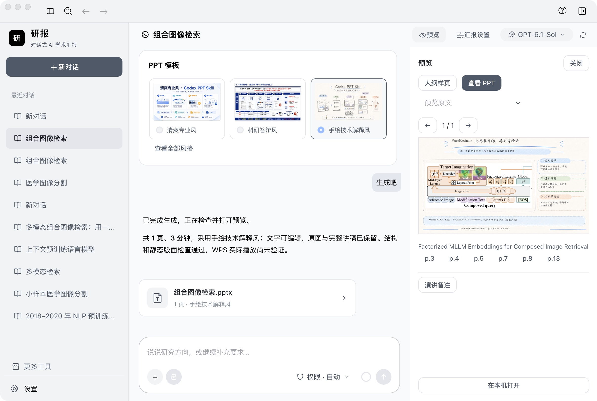

# 研报 · Paper2Talk

### 把科研材料，变成讲得清楚的演示。

从一个研究方向，或几篇论文开始，通过对话完成文献筛选、内容梳理、大纲讨论、PPT 生成与逐页讲稿。

**文献汇报 · 科研展示 · 毕业答辩材料整理 · 学术演讲**



## 为什么做研报

做科研演示，难的不只是排版。更花时间的是：找到值得讲的材料，弄懂创新点与方法原理，挑出能支持结论的图表，再把它们组织成听众能跟上的叙述。

研报把这些工作放进一段持续的对话。你可以从「帮我看看组合图像检索」这样一句话开始，再逐步确定讲什么、怎么讲、用什么风格呈现。

## 核心能力

- **简短输入，也能开始。** 提供研究方向，让 AI 检索和推荐论文；已有材料则直接上传 PDF。候选论文在聊天中展示，先看核心内容，再决定选哪篇。
- **把创新点讲展开。** 围绕研究问题、已有方法的不足、具体改进、方法原理、实验依据和局限组织内容，而不只是压缩摘要。
- **用原文支撑结论。** 保留论文原图、表格与来源页码，在预览中对照原文，方便核查关键数据和论述。
- **先定内容，再做设计。** 先讨论逐页大纲，再在聊天中可视化选择 PPT 风格；论文、大纲、模板各自清晰呈现。
- **边聊边改，接着往下做。** 换论文、补要求、调整页数或修改某一页，继续在当前对话里提出。任务保留版本，过期结果不会覆盖新的要求。
- **整理历史对话。** 在每条研报的「⋯」菜单中归档或删除，也可以从「已归档」恢复。研报与关联的普通聊天同步归档、恢复和删除状态，删除前会再次确认。
- **交付可继续修改的 PPT。** 设计稿经过可编辑重建，保留原图和逐页讲稿，并加入手动推进的淡入切换。右侧可预览 PPT 与论文。

## 可以用来做什么

| 场景 | 如何使用 |
| --- | --- |
| 文献与组会汇报 | 从方向出发筛选论文，讲清创新、原理与实验依据 |
| 科研成果展示 | 围绕研究问题和已有材料，组织方法、结果与讨论 |
| 毕业答辩材料整理 | 根据提供的论文与研究材料，梳理贡献、证据和讲述顺序 |
| 学术演讲 | 根据听众、时长与重点调整大纲，配套生成逐页讲稿 |

当前已打通的主流程是论文到 PPT。答辩与演讲可沿用该流程组织材料；独立演讲稿文件导出尚未提供。

## 怎么用

```text
说研究方向 / 上传论文
        ↓
看推荐，选论文
        ↓
讨论并确认逐页大纲
        ↓
选择视觉风格
        ↓
生成 PPT 与逐页讲稿
        ↓
预览、核对，继续聊天修改
```

例如：

> 组合图像检索，一篇，六到八页。
>
> 就这篇，重点讲创新点和原理。
>
> 原图放大一点，这页少放文字。

## 本地运行

仓库目前提供源码。先按 [桌面端文档](AionUi/readme.md) 和 [后端文档](AionCore/ARCHITECTURE.zh-CN.md) 准备运行环境，并按现有锁文件安装依赖。

```bash
git clone https://github.com/Xtbreak/Paper2Talk.git
cd Paper2Talk/AionCore
cargo build --locked --bin aioncore
cd ../AionUi
npm run paper-talk
```

完整生成流程还需要配置：

- 本机 Codex 助手及可用的搜索能力。
- `codex-ppt-skill` 与 `image-to-editable-ppt-skill`，放在本仓库同级目录，或通过 `PAPER2TALK_SKILLS_ROOT` 指向它们的父目录。按各自文档准备独立的 `output/.venv` 环境。
- 当前生图适配使用本地 Codex OAuth 与 `gpt-image-2.5-flare`；可编辑重建使用 PaddleOCR，成品预览需要 `officecli`。这些能力需在本机可用。

密钥、个人配置、依赖环境和聊天记录不包含在仓库中，应用不会自动安装上述外部依赖。

## 当前状态

研报处于持续迭代阶段，已接入聊天式论文选择、大纲确认、模板选择、PPT 生成与预览。当前检索依赖 AI 的搜索能力；国内文献、全文和权威分区服务已预留设置入口，需要另行配置，不能保证每篇论文的分区信息都可核验。

生成效果取决于论文全文质量、模型与外部服务。用于正式汇报前，请核对数据、引用以及实际播放效果。当前发布源码，安装包尚未作为正式版本发布。

## 反馈与贡献

产品设计与维护：[Xtbreak](https://github.com/Xtbreak)。欢迎通过 [Issues](https://github.com/Xtbreak/Paper2Talk/issues) 分享使用反馈、问题与建议。

## 致谢与许可

研报基于 [AionUi](https://github.com/iOfficeAI/AionUi) 与 [AionCore](https://github.com/iOfficeAI/AionCore) 开发，感谢上游作者与贡献者。

论文材料处理复用了 [paper-skills](https://github.com/smallSheep123/paper-skills) 的部分资源；PPT 生成流程对接 [codex-ppt-skill](https://github.com/ningzimu/codex-ppt-skill) 和 `image-to-editable-ppt-skill`。

本项目由 Xtbreak 新增与修改的部分采用 Apache-2.0 许可，上游与第三方内容保留各自的版权及许可声明。详见 [LICENSE](LICENSE)、[NOTICE](NOTICE) 与 [作者说明](docs/AUTHORS.md)。
